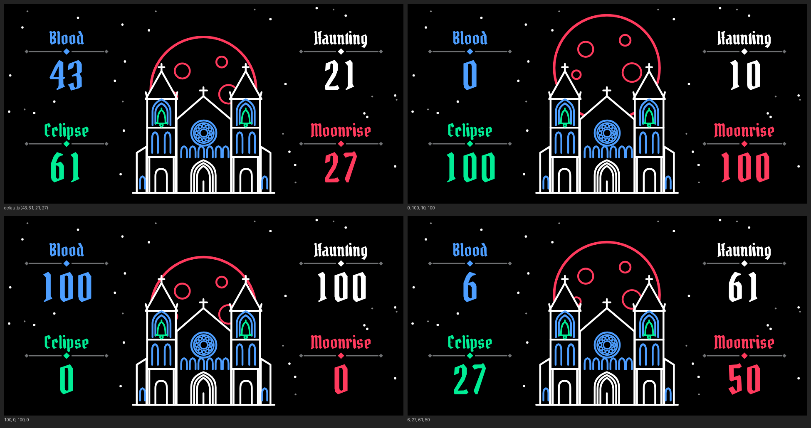

# BLOODMOON

**A dark organ with a haunted bell, for the original Teenage Engineering OP-1.**
A custom synth engine plugin by Nola Drift, made for gothic ambient, witch house and ruined cathedrals.

*Preview drawn on a computer from the plugin's own screen code. The OP-1's display may look slightly different.*

**Current stable version: v1.3.** Tested and playing well on a real OP-1 (R246). See [CHANGELOG.md](CHANGELOG.md).

**Experimental: v1.4 for Hundekraft 3.0 (`.knl`).** The same sound and screen packed as a Hundekraft kennel plugin, in [`knl/`](knl/INSTALL.md). It has not been tested on a real OP-1 yet.

🎥 [30-second demo](media/bloodmoon_demo.mp4) · [preset tour](media/bloodmoon_preset_tour.mp4) (rendered on a computer from the plugin's own sound and screen code)

---

## The sound

Every note is an organ: a fundamental with its 2nd, 3rd and 4th harmonics. A bell is struck on top of it, made of two inharmonic partials at about 1.19x and 2.41x the pitch (the lower one close to a minor third), so the bell never quite agrees with the organ. It rings, then sinks into the organ.

A slow vibrato fades in after about a tenth of a second, with a faint wobble underneath, so held notes drift out of tune like old pipes. Use the OP-1's own envelope (T2) to shape the attack and release.

## The four knobs

| Encoder | Name | What it does |
|---|---|---|
| Blue | **BLOOD** | Harmonic richness. Hollow and thin at the bottom, thick and dark at the top. |
| Green | **ECLIPSE** | The bell strike: how loud it hits and how long it rings. Fully down means no bell. Up means a loud, long, dissonant bell. |
| White | **HAUNTING** | Vibrato depth (up to about ±73 cents, fading in after the attack) plus a steady pitch instability (up to about ±18 cents). |
| Orange (drawn red on screen) | **MOONRISE** | Vibrato and wobble speed, from about 0.15 Hz to 9 Hz. Most of the knob's travel is spent in the slow end. |

The knobs start at about 43 %, 61 %, 21 % and 27 % (blue, green, white, orange).

## The screen

A black cathedral under a blood-red moon. Each knob moves the part of the picture drawn in its colour (the moon is drawn red, for the orange knob):

| Knob | On screen |
|---|---|
| MOONRISE | The moon rises from behind the cathedral as you turn it up. |
| BLOOD | The blue rose window turns, half a turn over the knob's travel. |
| ECLIPSE | The two green tower bells swing in opposite directions, up to about ±20 degrees. Still at zero. |
| HAUNTING | The white stars glow steadily at zero and flicker more as you turn it up. |

Each knob's name and its value (0 to 100) are drawn in blackletter on both sides of the cathedral, in the knob's own colour: Blood and Eclipse on the left, Haunting and Moonrise on the right.

## Presets

Eight presets are in `presets/bloodmoon/`. Back up your OP-1's `synth` folder first, then in disk mode copy the whole `bloodmoon` folder into `synth`. On an OP-1 without the plugin, they load as the stock iter engine.

| Preset | Blood | Eclipse | Haunting | Moonrise | Character |
|---|---|---|---|---|---|
| cathedral | 43 | 61 | 21 | 27 | the default sound, soft attack, delay |
| funeral bell | 27 | 100 | 8 | 12 | loud long bell, long release, delay |
| crypt drone | 92 | 0 | 27 | 8 | dark organ, slow attack, octave down |
| witch choir | 61 | 27 | 67 | 23 | heavy slow vibrato, delay |
| hollow saint | 0 | 37 | 11 | 18 | thin, hollow organ |
| moon tremor | 55 | 49 | 100 | 92 | fast, deep warble |
| sunken pipes | 79 | 12 | 40 | 5 | slow drifting pipes, octave down, delay |
| blood rite | 100 | 79 | 49 | 37 | thick organ with a strong bell, delay |

## Install

You need an **original OP-1** (not the Field), its original unmodified firmware file `op1_246.op1`, and the plugin file `bloodmoon.op1p`.

1. **Get the plugin file.** Download `bloodmoon.op1p` from the top of this repository (v1.3, tested) or from the **Releases** page. You can also [build it yourself](#build-it-yourself-no-coding-needed).
2. **Back up your OP-1** (tapes, synth and drum presets) using the OP-1's disk mode.
3. Open the [Hundekraft OP-1 Workshop](https://hundekraft.github.io/op1-workshop/index.html) and give it your original `op1_246.op1`.
4. Under **Your plugins**, add `bloodmoon.op1p`. The Workshop checks the file. If it shows a compatibility note, read it before you acknowledge it.
5. Build and install as the Workshop's page tells you (this normally means holding COM while switching the OP-1 on, to install firmware). If your OP-1 already runs a Hundekraft 3.0 firmware, you can connect it and use **Update OP-1** instead.
6. On the OP-1, press **T1** on a synth patch and choose **bloodmoon**. Start with the volume low.

## If something goes wrong

- If the OP-1 hangs while starting up, switch it off and on again. The Workshop's firmware leaves a marker file while it loads plugins and removes it once the screen has been running for about 7 to 10 seconds. If the marker is still there at the next start, it skips all plugin files for that boot.
- If it locks up later, or misbehaves in any way: switch it off, hold **COM** while switching it on, choose firmware update, and install a Workshop build without BLOODMOON. If your OP-1 already runs a Hundekraft 3.0 firmware, you can instead use the Workshop to remove the plugin. The Workshop says your tapes, album and presets stay in place.

## Build it yourself (no coding needed)

GitHub builds the plugin file for you on its free servers. You only click buttons.

1. Fork this repository (or copy `src/`, `Dockerfile` and `.github/workflows/build.yml` into a repository of your own).
2. Open the **Actions** tab, choose **Build BLOODMOON plugin**, then **Run workflow** and give it a release tag such as `v1.3`. The first run takes about an hour, almost all of it building the compiler.
3. When the run has a green tick, open it, scroll to **Artifacts** and download **bloodmoon-op1p**.
4. Unzip it. Inside is `bloodmoon.op1p`. The run also publishes it as a GitHub release under the tag you gave.

**Important:** never open `bloodmoon.op1p` in a text editor, and don't copy and paste its contents. That damages the file and the Workshop will refuse it. Just drag the file itself where it needs to go.

`HOW_TO_GET_BLOODMOON_OP1P.md` has the same steps in more detail.

## What's in this repository

| File | What it is |
|---|---|
| `bloodmoon.op1p` | The v1.3 plugin file, ready for the Workshop. |
| `src/` | All the source: the engine (`plugins/bloodmoon/bloodmoon.c`), the screen code (`moon.c`), the artwork (`bloodmoon.svg`), the plugin recipe (`plugin.json`), and the op1r SDK files needed to build it. |
| `src/tests/` | Tools that build the knob panels (`make_labels.py`) and presets (`make_presets.py`), the screen digit test (`screen_test.c`) and the preview renderer. |
| `Dockerfile` | The recipe for the Blackfin compiler. |
| `presets/bloodmoon/` | The 8 presets. |
| `CHANGELOG.md` | What changed in each version. |
| `knl/` | **Experimental** v1.4 Hundekraft 3.0 build: `bloodmoon.knl`, its source and install guide. Not yet tested on hardware. |
| `media/` | Demo and preset tour videos. |
| `releases/` | Older plugin files: v1.0, v1.1-louder (the old screen with the louder level, a fallback if the v1.2+ screen ever causes trouble) and v1.2. |
| `docs/` | Release posts for Reddit and Discord, and the changelog as a Word document. |
| `.github/workflows/build.yml` | The "Build BLOODMOON plugin" button on the Actions tab. |
| `HOW_TO_GET_BLOODMOON_OP1P.md` | Step-by-step build guide. |
| `bloodmoon_screen_preview.png` | The screen preview above. |

## How it was checked

| Check | Result |
|---|---|
| Sound engine on a computer, with memory-error detectors, at several knob settings | No problems found. At the default knobs the loudest peak is about -8.2 dBFS before the OP-1's envelope (v1.3). |
| The finished `bloodmoon.op1p` against the OP-1 plugin loader's checks and the Workshop's upload checks (checksum, format, size, name, screen-art rules) | Passes |
| The compiled Blackfin code run in a processor simulator, compared with the computer version across 34 knob, pitch and six-voice cases | Identical output, sample for sample. No out-of-bounds or misaligned memory access, no exceptions |
| Processor cost in that simulator | About 1.4 % of the audio time budget per voice, about 8.5 % for six voices at 400 MHz (a rough figure that leaves out memory delays; a pessimistic estimate is about 26 %) |
| Screen code in the simulator against the computer version, 588 knob and timing combinations | Identical |
| **On a real OP-1** | **v1.3 plays well, screen and knob panels show (R246). Presets not yet confirmed.** |

The simulator is not the OP-1's firmware. Cache and memory delays, interrupt timing, the real display and the contents of the firmware's own tables are only settled by running it on the device.

## Known limits

- The presets have not yet been confirmed on a real OP-1.
- The level is set so the OP-1's built-in speaker doesn't crackle (v1.2 was 3 dB louder and did). Six voices at full level on the speaker have not been checked.
- The screen animation assumes the OP-1 passes frame time in milliseconds. If the bells or stars look much too fast or too slow, please report it.
- The artwork is about 42 KB, above the Workshop's 8 KiB "artwork budget" (a guideline, not a limit). It shows fine on the OP-1. It also ends about 8 pixels above the bottom of the screen, and the Workshop's guide advises leaving room there, so check that nothing is cut off.
- Only the first page of four knobs is used.

## Feedback

Please open an issue and tell us your OP-1's firmware version (it should be R246), what you heard or saw, and any message the Workshop showed.

## Credits and licence

- BLOODMOON engine, screen code and artwork by **Nola Drift**.
- Built with the op1r plugin SDK by **pcppcp** and contributors ([op1r-src](https://github.com/pcppcp/op1r-src)). The structure follows the SDK's synth template, and the vibrato fade-in idea and screen structure follow the Brassophone plugin by **nvmsocool** and the SDK's example plugins.
- The knob lettering is outlines of Pirata One by Rodrigo Fuenzalida and Nicolas Massi (SIL Open Font License 1.1), credited in `NOTICE`.
- Installed with the [Hundekraft OP-1 Workshop](https://hundekraft.github.io/op1-workshop/index.html).
- OP-1 is a Teenage Engineering product. This project is not affiliated with or endorsed by Teenage Engineering and contains no Teenage Engineering firmware.

Licensed under **GPL-3.0-or-later with the additional OP-1 firmware permission** described in `LICENSE` and `NOTICE`. If you share the plugin file, share its source too. The `src/` folder in this repository is that source.
